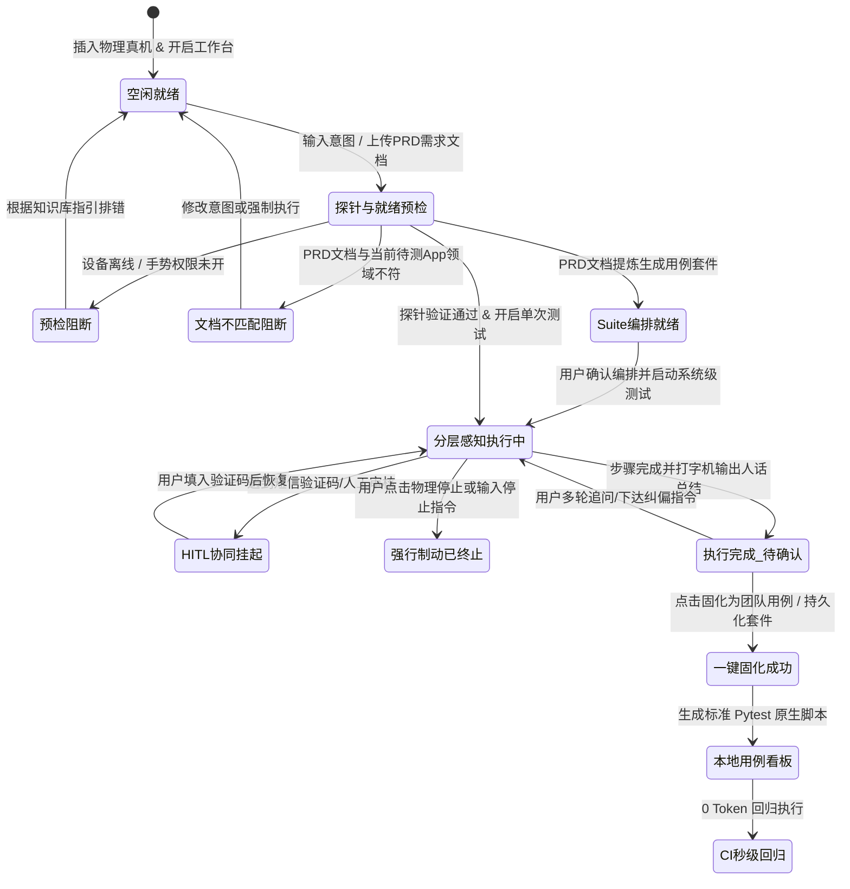

# Autotest AI 产品全景梳理与业务规格说明书 (Product Master Definition)

> **版本**：v2.5 (全场景智能测试、系统级编排与分层感知演进版)  
> **更新时间**：2026-11-04  
> **核心定位**：专为非专业测试人员（业务开发、PM、业务测试）打造的 **物理真机优先、多模态智能驱动与零 Token 原生脚本固化工作台**  
> **设计哲学**：**真机实测优先，坚决杜绝免机仿真 (Real-Device-First, Zero-Mock Policy)**

---

## 一、 产品定位与核心价值主张 (Value Proposition)

### 1.1 产品诞生背景与核心阻力
- **假跑与仿真陷阱**：市面上大量自动化工具在缺少真机时采用纯 Mock 或静态虚拟跑，无法发现真实移动端渲染抖动、定制机型权限拦截、系统底层手势冲突等致命问题，导致“线上通过、真机全崩”；
- **非专业人员的使用天堑**：业务 PM、功能测试与开发人员面对 ADB 命令行、复杂环境变量、Appium 驱动配置以及国产 ROM 的深度安全拦截（如小米 USB 安全设置、vivo 模拟点击）时，往往耗费数小时在环境搭设上，最终放弃自测；
- **需求与用例的脱节**：传统测试面对厚重的需求文档（PRD/Word/PDF），需要人工繁重提炼并逐条编写用例，难以快速串联多用例进行系统级现场闭环；
- **AI 纯视觉驱动的高延迟与高成本**：每一步操作均进行大图截图与远程 Vision 多模态推理，单步耗时高达 5~10 秒且 Token 费用高昂；
- **AI 与确定性回归的断层**：纯大模型执行极贵且不可控，而纯手工脚本编写成本极其脆弱。

### 1.2 产品核心价值闭环
Autotest AI 彻底打通了 **“需求/意图输入 ➔ 极速预检 ➔ 分层毫秒感知 ➔ 多模态驱动 ➔ 智能人话诊断 ➔ 零 Token 确定性固化”** 的全生命周期：

```mermaid
flowchart TD
    A[非专业用户: 上传PRD需求文档 / 输入自然语言意图] --> B{第0步: 物理真机、手势探针与文档相关性预检}
    B -- 设备离线 / 未开启安全调试 --> B1[知识库秒级弹出人话图文排查指引并硬拦截]
    B -- 文档与应用业务无关 --> B2[Doc Mismatch Guard 友好阻断并支持用户重构意图]
    B -- 预检通过 --> C{输入模式分流}
    C -- 需求文档输入 --> C1[Suite Builder: 智能提炼结构化用例套件并在前端 Generative UI 编排]
    C1 --> C2[串联多用例真机执行 (保持现场上下文 keep_state)]
    C -- 单条意图输入 --> D[分层感知三级火箭调度: UI树毫秒短路 / OCR / Vision 攻坚]
    C2 --> D
    D --> E[三栏工作台: 实时投屏 + 思考折叠 + 16ms打字机人话结论]
    E --> F{执行中遇到人机交互 / 业务阻断}
    F -- 遇到验证码 / 二次鉴权 --> F1[HITL 人机协同挂起: 前端卡片交互放行]
    F -- 用户输入停止 / 纠偏 --> F2[Intent Gate 意图拦截: 区分控制指令与业务Prompt]
    F -- 自测跑通 --> G[一键固化为标准原生 Pytest 脚本 & 持久化套件存盘]
    G --> H[存入团队用例库 / CI-CD 秒级 0 Token 回归]
```

---

## 二、 最新调整重塑的系统级核心产品能力体系

经过多轮重大工程落地与产品化重构，Autotest AI 构建了完备的断代技术护城河能力：

### 1. 🛡️ 物理真机优先与硬拦截机制 (Real-Device-First & Pre-flight Hard Check)
- **拒绝假跑**：彻底剔除免机仿真与假跑降级机制。系统坚持真实物理环境验证；
- **双重前置硬拦截**：
  1. *真机在线检测*：若无物理真机连接或设备离线，系统硬性拦截任务创建，给出明确指引，绝不产生无意义的假推演；
  2. *应用就绪拦截*：若待测包解析失败或无法安装，直接在第 0 步阻断退出，避免产生资损与时间浪费。

### 2. 🧠 设备画像与故障自进化知识库 (Self-Learning Knowledge Base)
- **毫秒级设备指纹感知**：自动采集真机品牌（小米/华为/OPPO/vivo/三星等）、型号、系统版本与定制 ROM 特征；
- **Cache-First 零秒避坑指引**：
  - 针对小米/红米（MIUI/HyperOS），提前提示开启【USB 调试（安全设置）】；
  - 针对 vivo（OriginOS），精准提示开启【USB 模拟点击】；
  - 针对 OPPO（ColorOS），提示【禁止权限监控】；
  - 针对华为（HarmonyOS），提示退出【纯净模式】。
- **未知故障 AI 自动演进存盘**：遇到新型未记录阻断时，系统自动捕获 logcat 与现场截屏，分析提炼根因后自动持久化沉淀至 `data/device_knowledge.json`，下一次相同机型直接命中缓存指引。

### 3. ⚡ 微秒级手势探针机制 (Gesture Pre-flight Probe)
- 在正式耗费高成本 AI Token 进行推理之前，后台首先执行一次极轻量的底层手势探针指令；
- 若手机底层因厂商权限拦截手势注入（`INJECT_EVENTS`），立即秒级阻断并弹窗告警，**从源头杜绝“跑了 15 步才发现根本点不动屏幕”的巨大 Token 与时间浪费**。

### 4. 📑 需求驱动用例智能生成与自由编排系统 (Suite Builder)
- **PRD/需求文档一键生成**：
  - 支持上传 `.docx`, `.pdf`, `.md`, `.txt` 等多种格式需求文档；
  - 核心引擎 `TestSpecSynthesizer` 基于大模型自动解析提炼出强类型用例套件（含模块划分、优先级 P0/P1/P2、操作目标与精准断言条件）；
- **Generative UI 交互式在线编排**：
  - 前端以现代极简卡片无缝呈现用例矩阵；
  - 支持双击直接编辑标题与断言、自由复选组合、拖拽上下调序、删除无效用例与增补自定义用例；
- **跨用例现场状态继承（Keep State）**：
  - 支持“保持现场串联执行”模式，在多个测试用例连续执行期间不杀进程，完整保留登录态与页面上下文，输出系统级全景测试报告；
  - 编排调整后的用例套件可持久化存盘至 `data/test_suites/` 供未来快速复跑。

### 5. 🛡️ 需求文档与待测应用相关性校验门禁 (Doc Mismatch Guard)
- **智能语义相关性判定**：
  - 提取文档核心领域词与当前待测 APK/应用元数据做语义交叉比对；
  - 若文档与当前待测应用无关（如在外卖 App 上传了外语教学文档），系统触发前置拦截；
- **自愈式 Generative UI 告警**：
  - 在对话流展示优雅警示卡片，清晰说明不匹配原因，并提供“重新确认/修改意图”与“仍要强制执行”双向选择，从源头杜绝盲目消耗 Token 与无效测试。

### 6. 🚀 分层感知三级火箭架构 (Layered Perception Architecture)
- **Level 1 (UI 树极速短路)**：
  - 若 UIAutomator 原生控件树信息充沛（富含文本、ID、清晰控件层级），感知层自动短路，跳过全量大图截屏与图片网络上传；
  - 采用结构化纯文本毫秒级直接决策，单步决策耗时从 5~8 秒直降至 **400~800ms**，Token 消耗节省超 **80%**；
- **Level 2 (端侧本地 OCR 补齐兜底)**：
  - 当页面为自绘 Webview / Flutter / H5 等导致原生 UI 树节点稀疏时，自动激活端侧轻量 OCR 补齐文字位置并以轻量文本决策；
- **Level 3 (视觉多模态大模型攻坚)**：
  - 仅在纯图标按钮、复杂图形滑块验证码或遇到阻断重试时，无缝升格为全量截屏 + 多模态视觉模型（Vision）攻坚，确保 100% 视觉兜底与稳定性。

### 7. 🤝 人机协同挂起与控制指令拦截中枢 (HITL & Intent Gate)
- **人机协同（Human-in-the-Loop, HITL）**：
  - 遇到短信验证码、生物识别或人工强校验场景，测试智能体优雅挂起，在前端渲染倒计时人机协同卡片；
  - 用户可在卡片中直接填入验证码放行，或一键点击取消终止；
- **控制指令拦截中枢 (Intent Gate)**：
  - 在多轮对话入口建立控制指令正则与模式识别；
  - 当任务处于等待或执行态时，用户在底部输入框输入“停止”、“终止”、“取消”、“退出”等词汇，系统第一时间拦截并优雅中止底层进程，坚决不将其误识别为追加测试业务步骤；
- **无重复流式渲染与 DOM 脏检查**：
  - 全面消除前端临时乐观节点与后端权威 Block 的冲突，通过 DOM 脏检查机制杜绝重复消息气泡与页面闪烁。

### 8. 🧱 统一时间线标准事件流 (借鉴 Vercel Labs json-render 契约护栏)
- **权威组件 Catalog 白名单**：
  - 依托 `TimelineManager` 建立受控的强类型 Block 契约（`user_message`, `system_notice`, `thought`, `todo_list`, `step_execution`, `suite_builder`, `doc_mismatch_guard`, `test_summary`, `fault_diagnosis`, `report`）；
  - 任何非规范数据结构自动安全降级，前端与后端数据契约严丝合缝，杜绝未知类型导致界面白屏。

### 9. ⚖️ 借鉴 DeepSeek Harness (DSH) 的三权分立与假阳性防护门禁
- **独立任务核验门禁（TaskVerifier Gate）**：
  - 剥夺执行大模型既当执行者又当裁判的权力，建立独立审查门禁，杜绝虚假达成（False Positive）；
- **真实凭证物理注入流水线（Credential Injection Pipeline）**：
  - 遇到登录鉴权阻断且配置了测试凭证时，系统自动执行真实输入：OCR 精准定位账号/密码框、物理键入凭证、智能勾选协议单选框并提交；
- **动态任务突变与自愈插桩（Plan Mutation）**：
  - 执行中感知到鉴权阻断时，任务中心在当前步骤后即时插桩 `[动态自愈] 自动注入测试凭证完成登录放行`；
- **终态核心断言守卫（Assertion Guard）**：
  - 核心断言步骤被跳过时坚决拒绝误判通过，如实定性为 `BLOCKED` 并以高质感琥珀金胶囊条展示。

### 10. 🖥️ 现代化三栏桌面级自测工作台 (Desktop-Grade 3-Column Workspace)
- **左侧会话归档区**：历史测试会话时间轴归档、运行中动态流转指示灯、模糊搜索与批量归档清理；
- **中央沉浸推演流**：采用流式对话卡片呈现；AI 内部推理过程封装为【Thought 深度思考】收起/展开折叠栏；16ms 节奏打字机效应；
- **右侧工作台 Canvas**：支持一键展开/收起，集成原生全量日志终端与低延迟真机实时投屏镜像；
- **待测应用胶囊、智能用例推荐与新手向导**：底栏应用胶囊快速切换包名，动态推荐用例网格一键填充，新手 4 步聚光灯向导一分钟上手。

---

## 三、 核心实体生命周期与业务规则契约

### 3.1 核心业务状态机



### 3.2 关键业务契约与非功能需求 (NFR)
1. **时效与即时反馈契约**：
   - 物理制动响应时间：≤ 1.0 秒（确保所有后台子进程完整被 kill）；
   - 设备画像与已知避坑匹配时效：≤ 200 毫秒（本地缓存优先，0 Token 延迟）；
   - 分层感知决策时效：原生充沛 UI 树纯文本短路模式单步 ≤ 800 毫秒；
   - 人话结论流式输出：固定 16 毫秒/字视觉打字机节奏，既保持生动性又避免卡顿。
2. **零 Token 资产固化与套件复用契约**：
   - 固化落盘的测试脚本必须存放在 `tests/solidified/`，必须为合规的纯 Python (Pytest + Requests + Appium/ADB) 源码，严禁包含任何必须在线调用的 LLM 动态推理语句；
   - 需求驱动提炼的用例套件落盘至 `data/test_suites/`，日后复跑无需重复解析文档；
   - 固化用例一键回归平均单步执行速度 ≤ 1.2 秒。
3. **数据隔离与安全防护**：
   - 敏感信息（密码、支付口令、Token）在轨迹记录与固化脚本中自动脱敏；
   - 本地设备画像与机型避坑规则存储在本地 `data/device_knowledge.json`，不上传外部公有云。

---

## 四、 核心价值验收衡量指标 (DoD)

| 验收维度 | 核心指标 | 达标验收条件 (DoD) |
| :--- | :--- | :--- |
| **易用性与上手速度** | 新人上手时间 (Time-to-Value) | 非专业人员在全屏新手向导指引下，首次完成真机自测全链路耗时 ≤ 3 分钟。 |
| **真机鲁棒性与防护率** | 权限死锁与手势阻断拦截率 | 针对主流机型（小米/vivo/OPPO/华为），手势探针与知识库指引在第 0 步拦截无效执行的准确率达到 100%。 |
| **执行性能与成本** | 感知短路加速比与 Token 节约 | 针对原生标准应用页面，分层感知短路决策命中率 ≥ 70%，端到端步骤耗时缩减 80% 以上。 |
| **系统级业务覆盖度** | 跨用例状态继承有效性 | 系统级测试在 `keep_state: true` 模式下，用例切换间保留前置登录态与页面上下文，成功率 100%。 |
| **交互控制力** | 物理停止有效性 | 点击停止按钮或输入控制指令后，1 秒内彻底切断进程与投屏流，成功率 100%。 |
| **资产确定性** | 固化用例复现成功率 | 固化生成的 Pytest 脚本在本地回归与 CI 环境中，脱离 LLM 独立执行通过率 100%。 |
