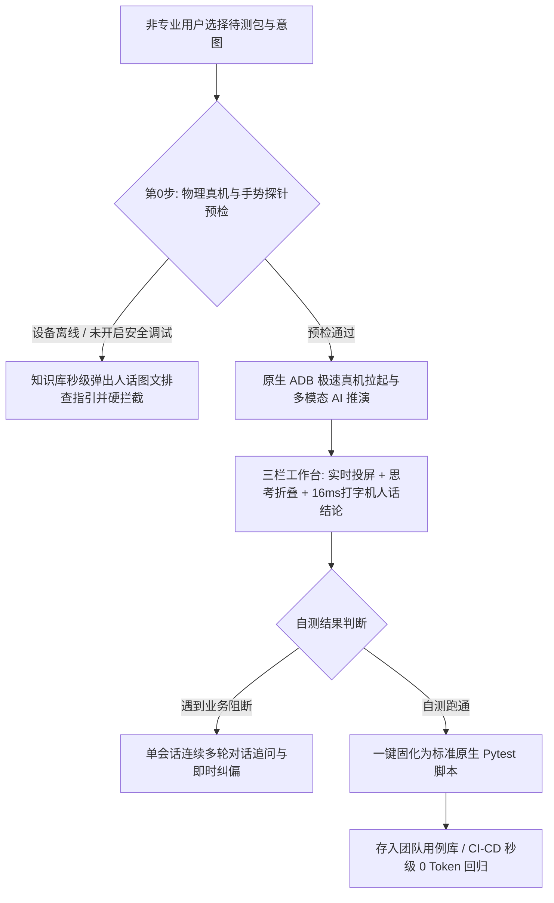

# Autotest AI 产品全景梳理与业务规格说明书 (Product Master Definition)

> **版本**：v2.0 (重大工程落地与产品化升级重构版)  
> **更新时间**：2026-10-20  
> **核心定位**：专为非专业测试人员（业务开发、PM、业务测试）打造的 **物理真机优先、多模态智能驱动与零 Token 原生脚本固化工作台**  
> **设计哲学**：**真机实测优先，坚决杜绝免机仿真 (Real-Device-First, Zero-Mock Policy)**

---

## 一、 产品定位与核心价值主张 (Value Proposition)

### 1.1 产品诞生背景与核心阻力
- **假跑与仿真陷阱**：市面上大量自动化工具在缺少真机时采用纯 Mock 或静态虚拟跑，无法发现真实移动端渲染抖动、定制机型权限拦截、系统底层手势冲突等致命问题，导致“线上通过、真机全崩”；
- **非专业人员的使用天堑**：业务 PM、功能测试与开发人员面对 ADB 命令行、复杂环境变量、Appium 驱动配置以及国产 ROM 的深度安全拦截（如小米 USB 安全设置、vivo 模拟点击）时，往往耗费数小时在环境搭设上，最终放弃自测；
- **AI 与确定性回归的断层**：纯大模型执行极贵且不可控，而纯手工脚本编写成本极其脆弱。

### 1.2 产品核心价值闭环
Autotest AI 彻底打通了 **“意图输入 ➔ 极速预检 ➔ 多模态驱动 ➔ 智能人话诊断 ➔ 零 Token 确定性固化”** 的全生命周期：

---

## 二、 最新调整重塑的七大核心产品能力

经过本轮深度工程落地与产品化重构，Autotest AI 确立了七大具有断代优势的护城河能力：

### 1. 🛡️ 物理真机优先与硬拦截机制 (Real-Device-First & Pre-flight Hard Check)
- **拒绝假跑**：彻底剔除免机仿真与假跑降级机制。系统坚持真实物理环境验证；
- **双重前置硬拦截**：
  1. *真机在线检测*：若无物理真机连接或设备离线，系统硬性拦截任务创建，给出明确指引，绝不产生无意义的假推演；
  2. *应用就绪拦截*：若待测包解析失败或无法安装，直接在第 0 步阻断退出，避免产生资损与时间浪费。

### 2. 🧠 设备画像与故障自进化知识库 (Self-Learning Knowledge Base)
- **毫秒级设备指纹感知**：自动采集真机品牌（小米/华为/OPPO/vivo/三星等）、型号、系统版本与定制 ROM 特征；
- **Cache-First 零秒避坑指引**：
  - 针对小米/红米（MIUI/HyperOS），提前提示开启【USB 调试（安全设置）】；
  - 针对 vivo（OriginOS），精准提示开启【USB 模拟点击】；
  - 针对 OPPO（ColorOS），提示【禁止权限监控】；
  - 针对华为（HarmonyOS），提示退出【纯净模式】。
- **未知故障 AI 自动演进存盘**：遇到新型未记录阻断时，系统自动捕获 logcat 与现场截屏，分析提炼根因后自动持久化沉淀至 `data/device_knowledge.json`，下一次相同机型直接命中缓存指引。

### 3. ⚡ 微秒级手势探针机制 (Gesture Pre-flight Probe)
- 在正式耗费高成本 AI Token 进行推理之前，后台首先执行一次极轻量的底层手势探针指令；
- 若手机底层因厂商权限拦截手势注入（`INJECT_EVENTS`），立即秒级阻断并弹窗告警，**从源头杜绝“跑了 15 步才发现根本点不动屏幕”的巨大 Token 与时间浪费**。

### 4. 🖥️ 现代化三栏桌面级自测工作台 (Desktop-Grade 3-Column Workspace)
- **左侧会话归档区**：历史测试会话时间轴归档、运行中动态流转指示灯、模糊搜索与批量归档清理；
- **中央沉浸推演流**：
  - 采用流式对话卡片呈现；
  - AI 内部推理过程封装为【Thought 深度思考】收起/展开折叠栏，信息层级干净清晰；
  - **16ms 节奏打字机效应**：测试完成时，像真人工程师汇报一样逐字流出通俗人话业务结论，历史会话刷新时直接静态呈现，杜绝重复渲染疲劳；
- **右侧工作台 Canvas**：支持一键展开/收起，集成原生全量日志终端与低延迟真机实时投屏镜像。

### 5. 🔄 单会话多轮追问与即时纠偏 (Multi-turn Interactive Steering)
- 彻底告别“测试一次失败就必须重新开新任务”的死板工作流；
- 在同一个自测会话内，用户可随时针对当前的界面状态发起追问或下达纠偏指令（如：“刚才没点中输入框，重新点击左下角重新输入”），系统自动结合当前屏幕上下文进行增量纠偏。

### 6. 🛑 物理级秒级紧急制动 (Real-time Physical Stop)
- 运行中输入框右侧动态切换为醒目的**黑色物理制动按钮**；
- 点击后触发系统底层进程树递归强制中止（`taskkill /F /T /PID`），网络管道、ADB 监听与页面推演流在 1 秒内瞬间静默停止，彻底杜绝后台游离耗电与失控扣费。

### 7. 🎯 待测应用胶囊、智能用例推荐与新手向导
- **待测应用胶囊**：底栏直接挂载应用胶囊，自动扫描 `apps/` 目录下的安装包，一键切换并核验真机安装态；
- **动态用例推荐网格**：根据当前应用特征自动生成智能用例卡片（涵盖核心主流程、异常输入校验、边界轮播等），支持 **🔄 换一批** 实时刷新，一键填充 Prompt 即刻起跑；
- **新手 4 步聚光灯向导**：真机连接 ➔ 选择应用 ➔ 选择大模型 ➔ 输入意图，帮助零基础新成员 1 分钟上手。

---

## 三、 核心实体生命周期与业务规则契约

### 3.1 核心业务状态机

```mermaid
stateDiagram-v2
    [*] --> 空闲就绪: 插入物理真机 & 开启工作台
    空闲就绪 --> 探针与就绪预检: 输入意图点击开始
    探针与就绪预检 --> 预检阻断: 设备离线 / 手势权限未开
    预检阻断 --> 空闲就绪: 根据知识库指引排错
    探针与就绪预检 --> 多模态AI执行中: 探针验证通过
    多模态AI执行中 --> 强行制动已终止: 用户点击物理停止按钮
    多模态AI执行中 --> 执行完成_待确认: 步骤完成并打字机输出人话总结
    执行完成_待确认 --> 多模态AI执行中: 用户多轮追问/下达纠偏指令
    执行完成_待确认 --> 一键固化成功: 点击固化为团队用例
    一键固化成功 --> 本地用例看板: 生成标准 Pytest 原生脚本
    本地用例看板 --> CI秒级回归: 0 Token 回归执行
```

### 3.2 关键业务契约与非功能需求 (NFR)
1. **时效与即时反馈契约**：
   - 物理制动响应时间：≤ 1.0 秒（确保所有后台子进程完整被 kill）；
   - 设备画像与已知避坑匹配时效：≤ 200 毫秒（本地缓存优先，0 Token 延迟）；
   - 人话结论流式输出：固定 16 毫秒/字视觉打字机节奏，既保持生动性又避免卡顿。
2. **零 Token 资产固化契约**：
   - 固化落盘的测试脚本必须存放在 `tests/solidified/`，必须为合规的纯 Python (Pytest + Requests + Appium/ADB) 源码，严禁包含任何必须在线调用的 LLM 动态推理语句；
   - 固化用例一键回归平均单步执行速度 ≤ 1.2 秒。
3. **数据隔离与安全防护**：
   - 敏感信息（密码、支付口令、Token）在轨迹记录与固化脚本中自动脱敏；
   - 本地设备画像与机型避坑规则存储在本地 `data/device_knowledge.json`，不上传外部公有云。

---

## 四、 核心价值验收衡量指标 (DoD)

| 验收维度 | 核心指标 | 达标验收条件 (DoD) |
| :--- | :--- | :--- |
| **易用性与上手速度** | 新人上手时间 (Time-to-Value) | 非专业人员在全屏新手向导指引下，首次完成真机自测全链路耗时 ≤ 3 分钟。 |
| **真机鲁棒性与防护率** | 权限死锁与手势阻断拦截率 | 针对主流机型（小米/vivo/OPPO/华为），手势探针与知识库指引在第 0 步拦截无效执行的准确率达到 100%。 |
| **交互控制力** | 物理停止有效性 | 点击停止按钮后，1 秒内彻底切断进程与投屏流，成功率 100%。 |
| **资产确定性** | 固化用例复现成功率 | 固化生成的 Pytest 脚本在本地回归与 CI 环境中，脱离 LLM 独立执行通过率 100%。 |
