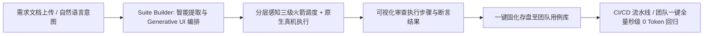
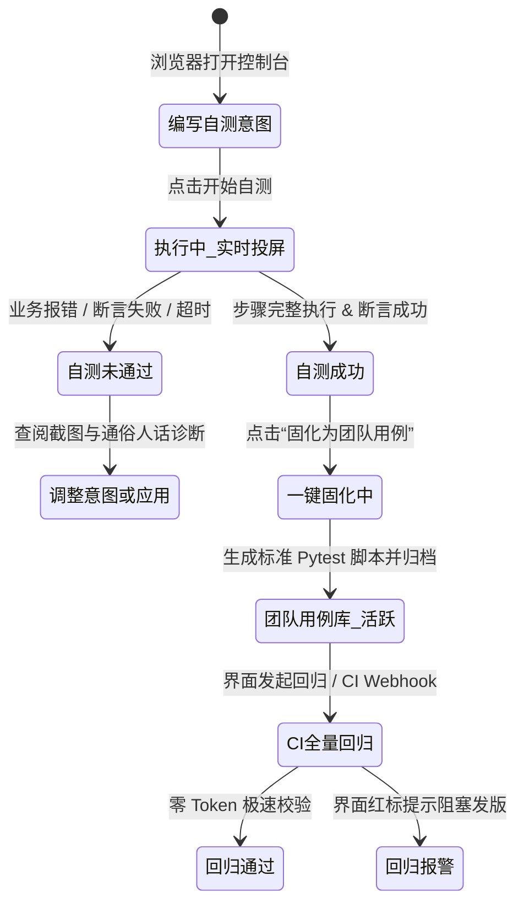

# Autotest 产品规划与路线图方案 (Product Roadmap & Strategy)

> **版本**：v2.5（系统级编排与分层感知架构全面交付重构版）  
> **制定周期**：2025Q2 - 2026Q4  
> **核心定位**：专为非专业测试人员（业务开发、PM、业务测试）打造的 **物理真机优先、多模态智能驱动与零 Token 原生脚本固化工作台**  
> **方法论遵循**：ProductOS 业务边界界定 · 零和容量原则（70/20/10） · 渐进式迭代交付

---

## 一、 战略转向背景与核心价值主张

### 1.1 关键洞察（从单步自测走向系统级业务编排）
- **非专业人员的真实使用门槛**：本产品根本目标客群是**非专业测试人员（业务功能测试、前端/全栈开发、产品经理、运营）**。对于该群体而言，纯 CLI 命令行 + 本地跑 Python/Pytest 的“极客模式”存在巨大认知断层。
- **从“单句盲测”到“需求文档驱动与自由编排”**：单纯输入一句话容易产生测试盲区；而非专业测试人员手头往往有现成的需求文档（PRD/Word/PDF）。通过大模型智能提取并结合 Generative UI 让人原地微调编排，在保持真机现场上下文（`keep_state: true`）下连续探索，构筑了真正的系统级自测闭环。
- **三级火箭分层感知破解高成本高延迟**：单步 5~10 秒的视觉全量大图调用在大规模测试中不可接受，通过原生 UIAutomator 控件树纯文本毫秒级短路，单步提速 80%，彻底扫平规模化推广障碍。

### 1.2 核心价值主张 (Value Proposition)
1. **零代码、零环境配置自测**：非专业人员通过浏览器 Web 控制台输入一段业务话术或上传 PRD 文档，即可自动驱动移动端设备完成全链路操作；
2. **看得见的实时执行反馈**：控制台提供真机低延迟投屏与步骤执行标注，界面点到哪、断言验什么一目了然；
3. **团队资产即时沉淀**：自测成功后“一键固化”，系统自动在后台生成标准 Pytest 脚本并沉淀为团队共享用例，彻底告别写代码与维护定位器的噩梦；
4. **低边际成本与发版防护**：固化后的用例支持一键批量回归与 CI/CD 触发，0 Token 成本、秒级执行，为非专业团队筑牢防线。

---

## 二、 路线图交付看板 (Now / Delivered / Next)

### 2.1 已交付核心版本 (Delivered)

| 版本阶段 | 交付周期 | 核心交付成果与业务价值 |
| :--- | :--- | :--- |
| **v1.0 团队可视化自测基线** | 2026-10 | - 三栏极简桌面级 Web 交互工作台（会话、推演流、实时投屏/终端） - 原生 ADB 极速真机驱动，杜绝免机仿真与假跑 - 设备画像自学习避坑知识库（Cache-First 秒级图文指引） - 毫秒级底层手势探针硬拦截 - 16ms 打字机通俗人话诊断结论与一键 Pytest 脚本固化 |
| **v2.0 质量门禁与容错护栏** | 2026-10 | - 独立任务核验门禁（TaskVerifier Gate），杜绝虚假达成与假阳性 - 真实凭证物理注入流水线与动态自愈插桩（Plan Mutation） - 终态核心断言守卫（Assertion Guard），核心断言跳过一票否决 - 物理级秒级紧急制动（taskkill 进程树递归终结） |
| **v2.5 系统级编排与分层感知架构 (当前最新)** | 2026-11 | - **Suite Builder 需求驱动用例智能生成与自由编排**（支持 Word/PDF/MD 上传，Generative UI 原地编辑调序，`keep_state: true` 跨用例现场上下文继承） - **Doc Mismatch Guard** 文档与应用业务语义相关性防护门禁 - **分层感知三级火箭架构**（原生 UI 树毫秒短路 ➔ 本地 OCR 兜底 ➔ 视觉 Vision 攻坚，提速 80%，Token 节省 80%） - **HITL 人机协同挂起与控制指令拦截中枢**（精准识别“停止”、“终止”等控制指令，彻底杜绝指令被当作测试 Prompt） - **统一时间线事件流与标准 Catalog**（借鉴 Vercel Labs json-render 强类型契约，前端 DOM 脏检查防闪烁） |

### 2.2 Next（下一步重点演进方向）

1. **多设备矩阵并发调度与兼容性自测**：
   - 支持单套用例套件同时下发至多台不同品牌/屏幕分辨率的物理真机（小米、vivo、OPPO、华为等），并行收集各设备执行状态与截屏差异；
2. **跨平台设备生态拓展（iOS 真机轻量化接入）**：
   - 探索基于标准化 WebDriver 代理的 iOS 真机轻量免越狱调试链路，拓展自测设备矩阵；
3. **探索性无剧本 AI 巡检（Exploratory Monkey）**：
   - 在业务闲时自动探索未覆盖的边缘路径与异常弱网边界，自动沉淀异常日志与崩溃复现场景。

---

## 三、 产品实体生命周期与关键业务规则

### 3.1 核心业务实体状态机

### 3.2 关键业务契约与非功能需求 (NFR)
1. **极简操作交互体验 (UX)**：
   - 核心自测流程必须在 **3 步内闭环**：选择设备 ➔ 输入意图 ➔ 点击执行；
   - 错误提示必须转化为“产品/业务人话”（例如：“未在当前界面找到‘确定’按钮，当前处于登录页”，严禁直接暴露 `NoSuchElementException` 堆栈）。
2. **实时画面流畅性**：
   - Web 控制台真机投屏延迟控制在 500ms 以内，帧率 ≥ 15fps，满足非专业人员实时观察执行的要求。
3. **零成本与高确定性**：
   - 固化用例在回归执行时严格脱离大模型，0 Token 开销，单步响应耗时 ≤ 1.5s。

---

## 四、 核心价值验收指标 (DoD & Metrics)

| 阶段 | 核心指标 (North Star Metric) | 达标验收条件 (DoD) |
| :--- | :--- | :--- |
| **首期 (Now: v1.0)** | **非专业人员自测完成率 & 固化转化率** | 1. 非专业人员无需接触终端命令行，在 Web 端 3 分钟内完成一次“安装-登录-业务-断言”完整自测； 2. 投屏延迟 ≤ 500ms，步骤时间线与截图精准对齐； 3. 自测成功用例可一键固化为标准用例，团队成员可在界面查阅并一键触发秒级复测； 4. 提供可用的 Webhook 接口供 CI 流水线触发执行。 |
| **远期 (Later: v2.0)**| **团队自测覆盖率 & 线上缺陷拦截率** | 研发发版前非专业人员自测覆盖 80% 核心功能分支，自测拦截缺陷占比 ≥ 50%。 |
