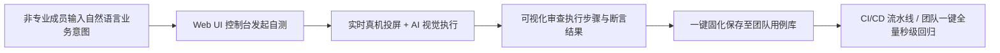
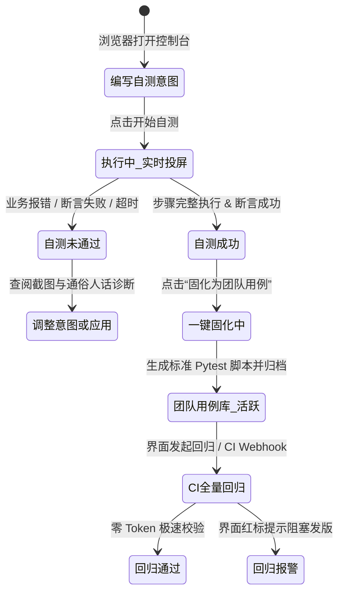

# Autotest 产品规划与路线图方案 (Product Roadmap & Strategy)

> **版本**：v1.1.0（战略重大调整：面向非专业测试团队协作自测全面重构）  
> **制定周期**：2025Q2 - 2025Q4  
> **核心定位**：专为非专业测试人员（业务开发、PM、业务测试）打造的 **AI 移动端可视化自测与用例一键固化协作平台**  
> **方法论遵循**：ProductOS 业务边界界定 · 零和容量原则（70/20/10） · Now/Next 战略合并交付

---

## 一、 战略转向背景与核心价值主张

### 1.1 关键洞察（为什么 Now 与 Next 必须合并执行？）
- **非专业人员的真实使用门槛**：本产品根本目标客群是**非专业测试人员（业务功能测试、前端/全栈开发、产品经理、运营）**。对于该群体而言，纯 CLI 命令行 + 本地跑 Python/Pytest 的“极客模式”存在巨大认知断层——他们不会配置 Python 虚拟环境，无法排查 Appium 终端报错，更无法脱离界面查看真机执行状态。
- **孤立工具无法形成“团队协作”闭环**：单机 CLI 工具只能个人试玩，无法沉淀用例给团队成员共享，无法一键触发发版前回归，更无法在非专业团队内推广。
- **战略决议**：**彻底将原 Now（AI 意图驱动引擎 + 固化器）与 Next（Web UI 可视化控制台 + 团队协作自测 + CI/CD 接入）合并为首期（v1.0）交付核心**。首期即交付带有直观界面、支持真机投屏、自然语言输入、一键固化入库的完整团队级自测平台。

### 1.2 核心价值主张 (Value Proposition)
1. **零代码、零环境配置自测**：非专业人员通过浏览器 Web 控制台输入一段业务话术，即可自动驱动移动端设备完成全链路操作；
2. **看得见的实时执行反馈**：控制台提供真机低延迟投屏与步骤执行标注，界面点到哪、断言验什么一目了然；
3. **团队资产即时沉淀**：自测成功后“一键固化”，系统自动在后台生成标准 Pytest 脚本并沉淀为团队共享用例，彻底告别写代码与维护定位器的噩梦；
4. **低边际成本与发版防护**：固化后的用例支持一键批量回归与 CI/CD 触发，0 Token 成本、秒级执行，为非专业团队筑牢防线。

---

## 二、 路线图规划 (战略合并后的 Now/Later 看板)

严格执行 **容量约束与零和原则（Zero-Sum Discipline）**。当期（Now）因合并 Web UI 与团队协作导致交付面大幅扩大，工程资源必须向“非专业人员易用性”与“自测闭环”极度聚焦。

### 2.1 Now（首期承诺交付：v1.0 非专业人员团队可视化自测平台）
> **承诺目标**：交付开箱即用的 Web UI 控制台，支持非专业人员在浏览器中输入自然语言、实时查看真机投屏自测、可视化固化入库并支持一键回归与 CI 触发。

| 容量类型 | 占比 | 规划特性 / 模块 | 业务目标与价值（面向非专业团队自测） |
| :--- | :---: | :--- | :--- |
| **核心交付** | 70% | **1. Web UI 可视化自测控制台** - 简洁自然的意图输入框与执行面板 - 浏览器内真机/模拟器实时投屏与步骤高亮 - 步骤执行流式时间线与多模态截图标注 | 彻底消除命令行门槛，让 PM/开发能像看同事操作一样实时感知测试过程 |
| | | **2. 意图驱动与断言引擎 (Android 专精)** - 自然语言转换为点击/输入/滑动/等待等标准动作 - 业务级智能断言（支持文案存在、弹窗提示、接口返回验证） | 保障常用业务场景（安装、登录、表单提交、流程验证）一句话驱动成功率 |
| | | **3. 一键固化器与团队用例库管理** - 自测成功轨迹一键固化为标准用例 - 团队可视化用例库（分类、标签、单步审查、在线回放） - 后台自动生成原生 Pytest 脚本存入仓库 | 无需懂代码即可将探索经验转化为团队确定性回归资产 |
| | | **4. 一键回归与 CI/CD Webhook 触发** - Web 界面支持“一键全量自测回归” - 提供标准 Webhook / GitHub Actions 触发接口 | 支撑发版前快速回归卡点，回归过程 0 Token、秒级反馈 |
| **体验重构** | 20% | **5. 针对非专业人员的容错与交互自愈** - 针对网络卡顿、弹窗遮挡（如权限申请）的自动兜底处理 - 界面定位器轻量重试与友好错误人话提示（不报生涩栈追踪） | 杜绝非专业人员面对“系统抛异常”时的挫败感与沟通成本 |
| **探索实验** | 10% | **6. 历史自测轨迹意图模板化推荐** - 基于团队沉淀的高频意图推荐常用自测话术 | 降低首次输入意图时的思考成本 |

#### 🚫 严苛的零和取舍（砍掉与延后项）：
由于 Now 与 Next 合并导致工作量剧增，为确保按期高质量交付，**执行以下重大战略减法**：
1. **砍掉/延后 iOS 真机深水区支持**：
   - *战略依据*：iOS 真机涉及 WebDriverAgent 编译、企业证书重签名、WDA 证书过期等极端复杂繁重的配置，非专业人员根本无法维护。首期 100% 专精 Android（真机即插即用 + 模拟器一键启动），收敛设备复杂度。
2. **砍掉分布式多机集群与复杂设备农场调度**：
   - *战略依据*：非专业自测场景下，核心是“发起测试 ➔ 实时看投屏 ➔ 确认固化”，首期采用单任务队列/排队执行即可完全满足团队日常自测需求，坚决不做复杂的分布式调度中间件。
3. **砍掉 PRD 文档全自动逆向用例推导**：
   - *战略依据*：全自动逆向生成由于语义歧义极易造成幻觉，非专业测试人员更相信“自己亲眼看着跑通并固化”的用例。
4. **恪守产品经理职责边界**：
   - 坚决不越界输出数据库物理 DDL、微服务架构 ADR 或工程实现代码，技术实现细节全权由技术团队根据业务契约裁定。

---

### 2.2 Later（远期规划：v2.0 企业级多平台与智能化质量中台）
> **战略方向**：在非专业人员自测打通并沉淀大量资产后，向企业级广度与深度演进。

1. **跨平台全覆盖（iOS 真机生态接入）**：引入云真机方案或打包免签代理，降低 iOS 真机配置门槛；
2. **多设备矩阵并发与兼容性自测**：支持多分辨率、多 Android 版本的并行验证；
3. **智能探索性 Monkey 与无剧本巡检**：利用大模型作为“AI 测试员”在夜间进行无预设边界的长链路探索。

---

## 三、 产品实体生命周期与关键业务规则

### 3.1 核心业务实体状态机

### 3.2 关键业务契约与非功能需求 (NFR)
1. **极简操作交互体验 (UX)**：
   - 核心自测流程必须在 **3 步内闭环**：选择设备 ➔ 输入意图 ➔ 点击执行；
   - 错误提示必须转化为“产品/业务人话”（例如：“未在当前界面找到‘确定’按钮，当前处于登录页”，严禁直接暴露 `NoSuchElementException` 堆栈）。
2. **实时画面流畅性**：
   - Web 控制台真机投屏延迟控制在 500ms 以内，帧率 ≥ 15fps，满足非专业人员实时观察执行的要求。
3. **零成本与高确定性**：
   - 固化用例在回归执行时严格脱离大模型，0 Token 开销，单步响应耗时 ≤ 1.5s。

---

## 四、 核心价值验收指标 (DoD & Metrics)

| 阶段 | 核心指标 (North Star Metric) | 达标验收条件 (DoD) |
| :--- | :--- | :--- |
| **首期 (Now: v1.0)** | **非专业人员自测完成率 & 固化转化率** | 1. 非专业人员无需接触终端命令行，在 Web 端 3 分钟内完成一次“安装-登录-业务-断言”完整自测； 2. 投屏延迟 ≤ 500ms，步骤时间线与截图精准对齐； 3. 自测成功用例可一键固化为标准用例，团队成员可在界面查阅并一键触发秒级复测； 4. 提供可用的 Webhook 接口供 CI 流水线触发执行。 |
| **远期 (Later: v2.0)**| **团队自测覆盖率 & 线上缺陷拦截率** | 研发发版前非专业人员自测覆盖 80% 核心功能分支，自测拦截缺陷占比 ≥ 50%。 |
